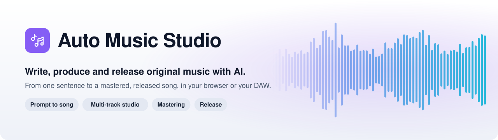
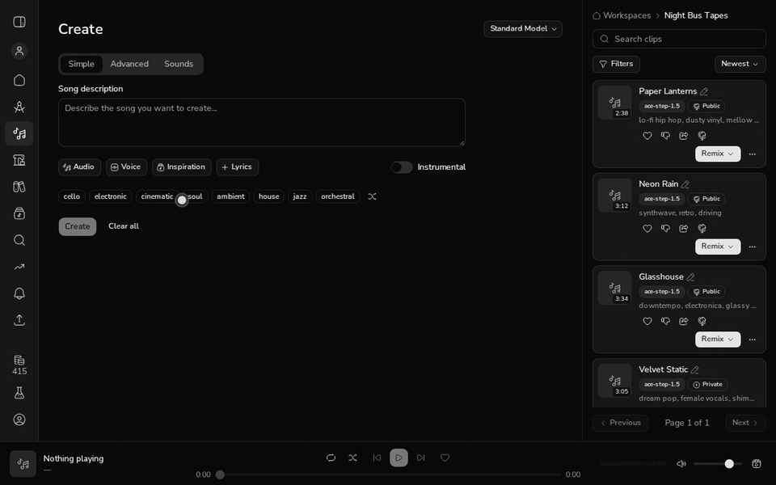
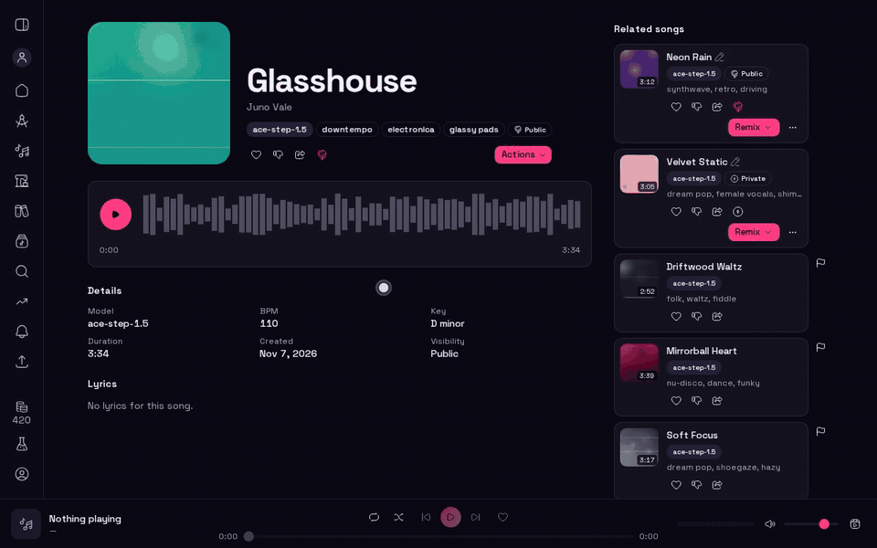
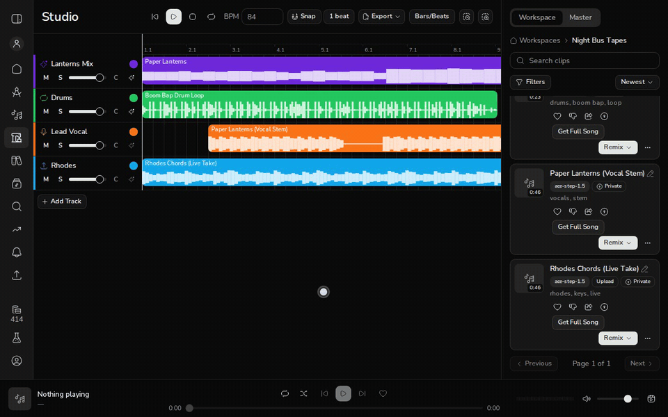
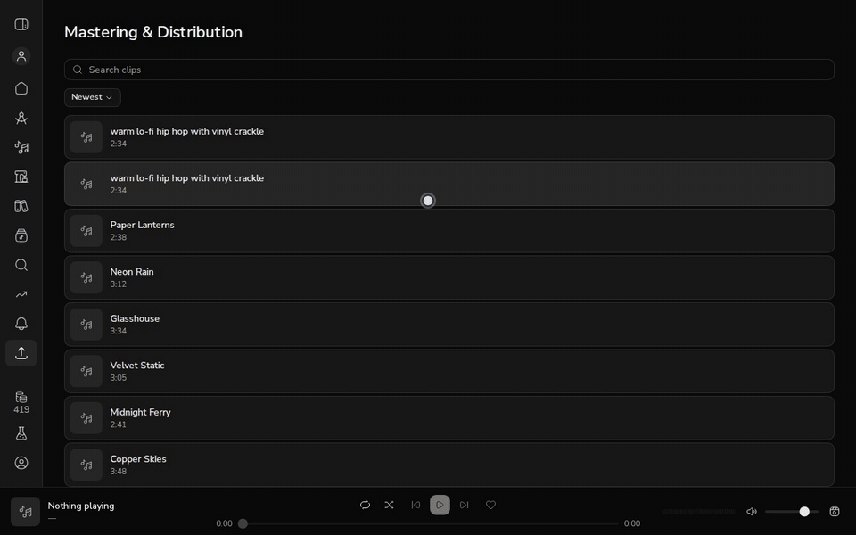
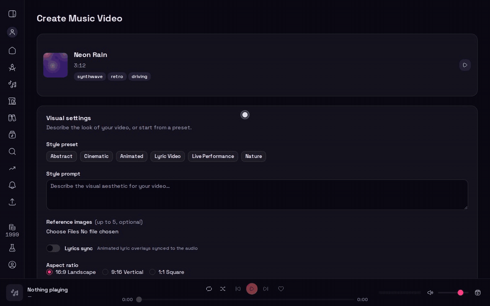
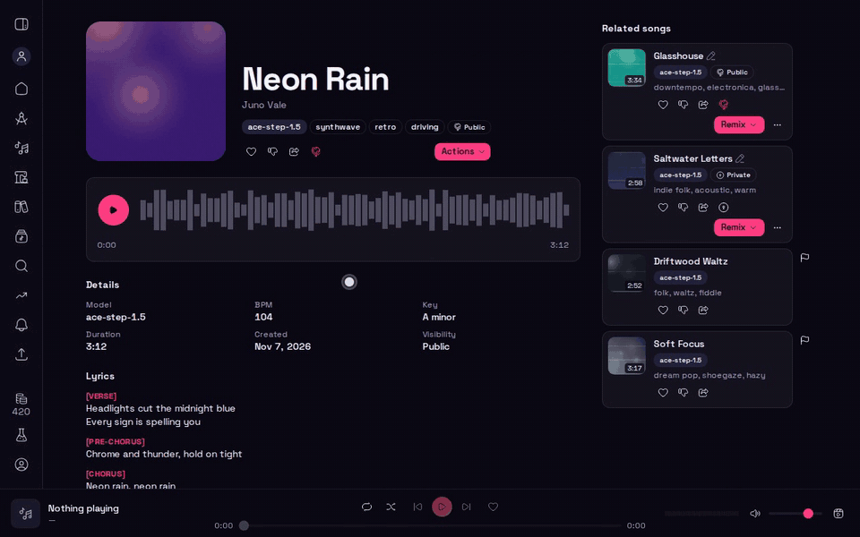
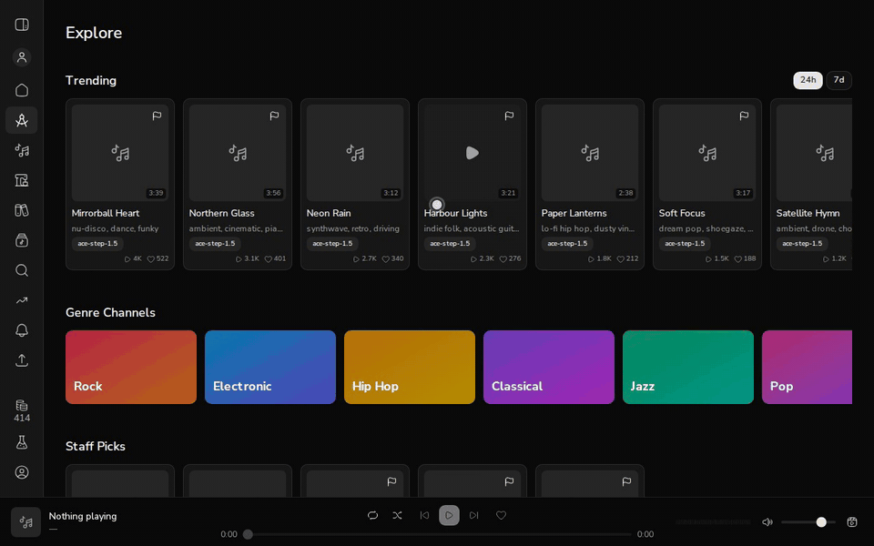
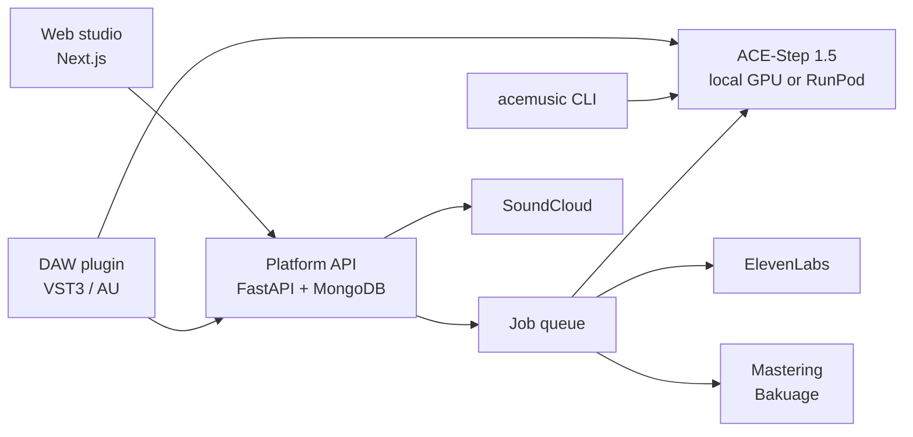

<div align="center">

<picture>
  <source media="(prefers-color-scheme: dark)" srcset="docs/readme/banner-dark.svg">
  
</picture>

<br>

**Describe a song. Hear it in minutes. Shape it, master it, and release it — all in one studio.**

<a href="https://www.automusicstudio.com"><b>Start free →</b></a>
&nbsp;·&nbsp;
<a href="#run-it-yourself">Run it yourself</a>
&nbsp;·&nbsp;
<a href="#plans">Plans</a>
&nbsp;·&nbsp;
<a href="docs/development.md">Developer guide</a>

<br>

[](https://github.com/frankbria/auto-music-studio/actions/workflows/ci.yml)
[](https://github.com/frankbria/auto-music-studio/actions/workflows/plugin.yml)


<br>



</div>

---

## One studio, from idea to listeners

Most AI music tools stop at "here's a clip". Auto Music Studio is built for what comes next: turning a
first take into a finished song, and getting that song in front of people.

| | |
| --- | --- |
| 🎼 **Create** | Full songs from a sentence, with your own lyrics, BPM, key and length. Loops and one-shots for producers. |
| ✂️ **Shape** | Extend, repaint a section, add a vocal, cover it in another genre, mash two songs together, split stems. |
| 🎛️ **Arrange** | A multi-track studio in the browser, with mixdown and export straight into your DAW. |
| 🎚️ **Master** | Professional AI mastering through Bakuage, or a one-click loudness remaster. |
| 🚀 **Release** | AI cover art, release metadata, publishing to SoundCloud, and guided prep for DistroKid, TuneCore and LANDR. |
| 🎬 **Video** | Music videos in six visual styles, up to 4K, with lyric sync. |
| 🎤 **Your voice** | Train a custom voice model and hear your songs sung in it. |
| 🔌 **Everywhere** | The web app and a VST3/AU plugin inside your DAW share one account; a command-line tool runs against your own ACE-Step server. |

---

## Create

Write what you hear in your head. Simple mode takes one sentence; Advanced mode adds lyrics, structure,
tempo, key, seed and model choice; Sounds mode makes loops and one-shots for your own productions.
A generation that fails refunds its credits.

Generation runs on **ACE-Step 1.5**, an open music model you can run on your own GPU, with ElevenLabs
available as a cloud backend for composition plans and short samples.

## Shape every section

A first take is a starting point. Keep the parts you love and redo the rest:

- **Extend** a clip from its end or any timestamp, and **Full song** grows a short idea into a complete
  intro → verse → chorus → bridge → outro arrangement.
- **Repaint** or **replace** a section with new instructions, blended in with crossfades.
- **Cover** a song in a new style, **add a vocal** to an instrumental, or **mash up** two songs with BPM alignment.
- **Stems and MIDI**: split a track into vocals, drums, bass and other, or pull melody, chords, drums and bass out as MIDI.



## Arrange in the Studio

Lay clips out on tracks, set volume and pan, solo and mute, and hear the whole arrangement play back.
Mix it down to WAV, FLAC or MP3, or export a DAW bundle with every track as a separate stem.



## Master it, release it

Send a finished song to **Bakuage** for AI mastering to a professional loudness target, or run a quick
loudness remaster in place. Generate cover art options, fill in the release metadata, and publish to
**SoundCloud** directly, or download a ready-to-submit bundle for **DistroKid**, **TuneCore** or **LANDR**.
Distribution status is tracked for you.



## Make the video

Turn a song into a music video: pick a style (cinematic, abstract, animated, lyric video, live performance
or nature), describe the look, sync the lyrics, and render in 16:9, 9:16 or square, up to 4K.



## Share and discover

Every song gets its own page with a waveform player. Make it public and it shows up on your artist profile,
in Search and in Explore's New Releases and genre channels. Trending and Charts rank songs by real plays,
likes and shares, and Staff Picks highlight hand-picked favourites. Playlists, a playback queue and a global player follow you around the app.





## In your DAW

The **Auto Music Studio plugin** (VST3 on Windows, macOS and Linux; AU on macOS) puts generation inside
your session. It follows the host tempo, generates to fit your selection, takes MIDI and sidechain audio
as input, builds a track layer by layer, and lets you drag results straight onto a track. Sign in to sync
clips with your workspace and sing in your own custom voice.

## From the terminal

The `acemusic` CLI talks straight to your ACE-Step server: generate, extend, repaint, cover, mash up,
split stems, manage workspaces and export, from a script or a headless box.


```bash
acemusic generate "dark electro" --bpm 128 --key "C minor" --duration 60
acemusic extend 42 --duration 30s --style "add a bridge feel"
acemusic full-song 42 --auto
acemusic export 42 --format flac
```

---

## Plans

Start free. Upgrade when your music needs more.

| | **Free** | **Pro** | **Enterprise** |
| --- | :---: | :---: | :---: |
| **Price** | $0 | **$24**/month<br>or $228/year | **$99**/month<br>or $998/year |
| **Credits every month** | 50 | 500 | 2,500 |
| Song and sound generation | ✓ | ✓ | ✓ |
| Extend, cover, repaint, mashup, add vocal | ✓ | ✓ | ✓ |
| Studio | View only | Full editing and mixdown | Full editing and mixdown |
| Convert and export to WAV / FLAC | | ✓ | ✓ |
| Stem separation and MIDI extraction | | ✓ | ✓ |
| Mastering | | ✓ | ✓ |
| Distribution and SoundCloud publishing | | ✓ | ✓ |
| Custom voice models | | ✓ | ✓ |
| Music video | 720p, watermarked | Up to 1080p | Up to **4K** |
| Rate limits | Standard | 3× | 10× |
| Priority job queue | | | ✓ |

Need more credits mid-month? Any plan can buy a top-up: **50 credits for $5**, **100 for $9** or
**250 for $20**. Prices in USD.

<p align="center"><a href="https://www.automusicstudio.com"><b>Start free at automusicstudio.com →</b></a></p>

---

## Built to be trusted

- **Your music is yours.** Songs are private until you publish them, and you choose who sees each one: private, unlisted or public.
- **Safe by default.** Every prompt, style and lyric is screened before generation, so a blocked request is never charged,
  and titles and release metadata are screened before anything is published. Listeners can report content, and a
  removal, content warning or video takedown can be appealed.
- **Fair billing.** Failed jobs refund their credits automatically, and the usage dashboard shows where every credit went.
- **Open foundations.** Generation runs on the open ACE-Step model, on your own GPU or on serverless GPUs through RunPod.

---

## Run it yourself

The whole platform (web app, API and database) runs from one Compose file:

```bash
cp .env.docker.example .env.docker
sed -i "s|^ACEMUSIC_API_JWT_SECRET_KEY=.*|ACEMUSIC_API_JWT_SECRET_KEY=$(openssl rand -hex 32)|" .env.docker
docker compose --env-file .env.docker up --build
```

The web app is at <http://localhost:3000> and the API at <http://localhost:8000> (Swagger at `/docs`).
Point it at an ACE-Step server for generation; [model-deployment.md](model-deployment.md) covers a local
GPU and RunPod.

### How it fits together



---

## Documentation

| Guide | What's in it |
| --- | --- |
| [Developer guide](docs/development.md) | Running from source, tests, the full API reference, backends, storage |
| [Deployment](docs/deployment.md) | Container images, CI/CD, staging and production |
| [Model deployment](model-deployment.md) | Running ACE-Step locally or on RunPod |
| [Voice models](docs/voice-models.md) | Training and using custom voices |
| [DAW plugin](plugin/README.md) | Building and installing the VST3/AU plugin |
| [Accessibility](docs/accessibility.md) · [Performance](docs/performance.md) | Audits and budgets for the web app |
| [Platform spec](ai-music-spec.md) | The full product specification |

## Licensing

Auto Music Studio has not yet published a licence for its own source. The licences chosen for
dual-licensed dependencies (JUCE and the VST3 SDK) are in the
[developer guide](docs/development.md#licensing) and [`plugin/LICENSE.md`](plugin/LICENSE.md).
