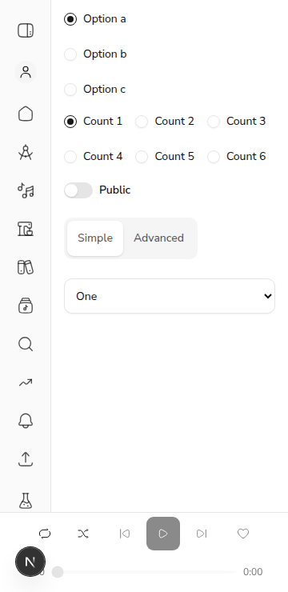

# #341 follow-up (PR #719): 44px touch targets for tabs, switches, radios, selects, feed rail and file input

*2026-11-02T19:00:36Z by Showboat 0.6.1*
<!-- showboat-id: 756ec7ad-5280-4573-a71b-c9b5fb52f912 -->

Chromium at 360x740 with touch emulation (Playwright `isMobile` + `hasTouch`, so `(pointer: coarse)` matches), against the web dev server on :3719. A temporary page mounts the shared Tabs, Switch, RadioGroup (one vertical group, the default `grid`, and one wrapping `flex flex-wrap gap-4` group), the `SELECT_CLASS` select and the real `VideoForm`. The page is deleted before commit. Sizes count an absolutely positioned `::after` hit area, as `scripts/mobile-audit.mjs` does. A "stolen tap" is a corner of a visible radio where the browser's hit test (`elementFromPoint`) lands on a different radio.

## Codex review: enlarged radio hit areas overlapped their neighbours
Run first without the PR's `pointer-coarse:gap-y-7` on `RadioGroup`, then with it:

```bash
R=web/components/ui/radio-group.tsx
sed -i "s/\"grid gap-2 pointer-coarse:gap-y-7\"/\"grid gap-2\"/" $R; sleep 4
echo "--- without the row spacing"; node $D/pw/touch.mjs http://localhost:3719/touch-demo $D/measure.js | grep "taps"
sed -i "s/\"grid gap-2\"/\"grid gap-2 pointer-coarse:gap-y-7\"/" $R; sleep 4
echo "--- with it (this PR)"; node $D/pw/touch.mjs http://localhost:3719/touch-demo $D/measure.js
git diff --quiet origin/fix/341-remaining-touch-targets -- $R && echo "unchanged" || echo "radio-group.tsx carries the fix"
```

```output
--- without the row spacing
vertical radios: taps on a visible radio that select another: v-a corner (81,31) -> v-b; v-a corner (95,31) -> v-b; v-b corner (81,55) -> v-c; v-b corner (95,55) -> v-c
horizontal radios: taps on a visible radio that select another: none
--- with it (this PR)
pointer: coarse = true
vertical radios: hit areas 44x44, 44x44, 44x44
vertical radios: taps on a visible radio that select another: none
horizontal radios: hit areas 44x44, 44x44, 44x44, 44x44, 44x44, 44x44
horizontal radios: taps on a visible radio that select another: none
switch: 44x44
tabs: 70x44, 89x44
select: 264x44
radio-group.tsx carries the fix
```

## The real VideoForm: radios and the reference-image file input

```bash
node $D/pw/touch.mjs http://localhost:3719/touch-demo $D/measure-video.js
```

```output
file input (#video-reference-images): 264x44
VideoForm radios (13): 44x44; taps that select another radio: none
```

## Feed rail buttons on /feed
Two seeded clips are made public in the throwaway `acemusic_demo_719` database, so `/feed` renders real items through the discover API.

```bash
node $D/pw/touch.mjs http://localhost:3719/feed $D/measure-feed.js | grep -E "coarse|clips shown|Like|Share" | sort -u
```

```output
clips shown: 2
pointer: coarse = true
rail? Like: 44x63
rail? Share: 45x63
```

The demo page at 360px with touch on. Vertical radio rows are now 44px apart, and tabs, the switch's hit area and the select are 44px tall:

```bash {image}

```


