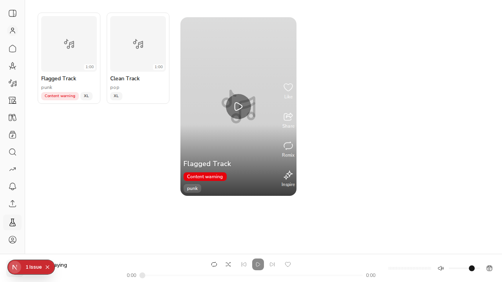

# #578: content-warning badge on Feed, Explore and Search cards

A clip that moderation marks `content_warning: true` now shows the same destructive **Content warning** badge as the song page (`SongHeader`) on every discovery card:

- `ExploreClipCard`: used by Explore's New Releases, Search results and profiles
- `FeedItemCard`: used by the Feed (solid fill so it reads on the dark scrim)

Both cards read the `content_warning` field that `/api/v1/discover/clips` already returns (#651).

## Evidence

Rendered in the dev server: a flagged Explore card, an unflagged Explore card (no badge), and a flagged Feed card.



Component tests on each card check that the badge appears for `content_warning: true` and is absent otherwise:

```
components/explore/ExploreClipCard.test.tsx  shows the content-warning badge only on a flagged clip (#578)
components/feed/FeedItemCard.test.tsx        shows the content-warning badge only on a flagged clip (#578)
```
