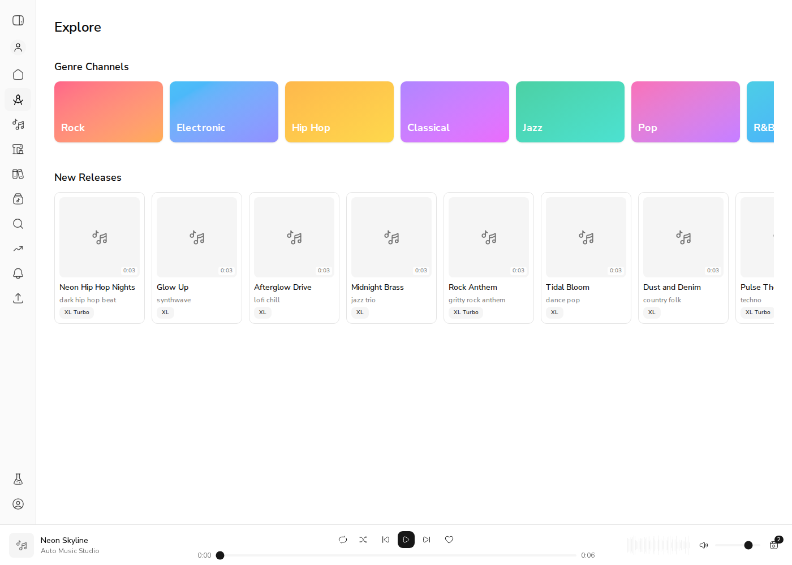
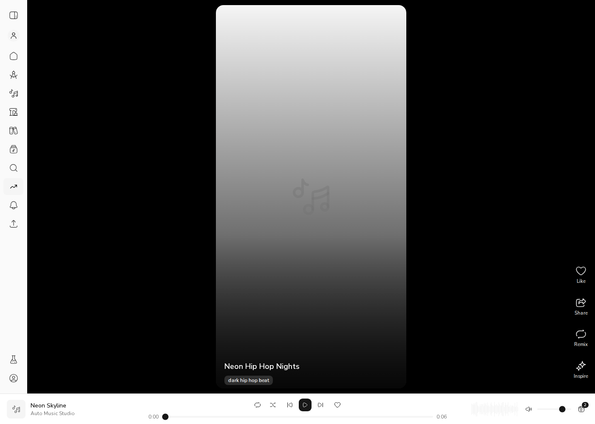
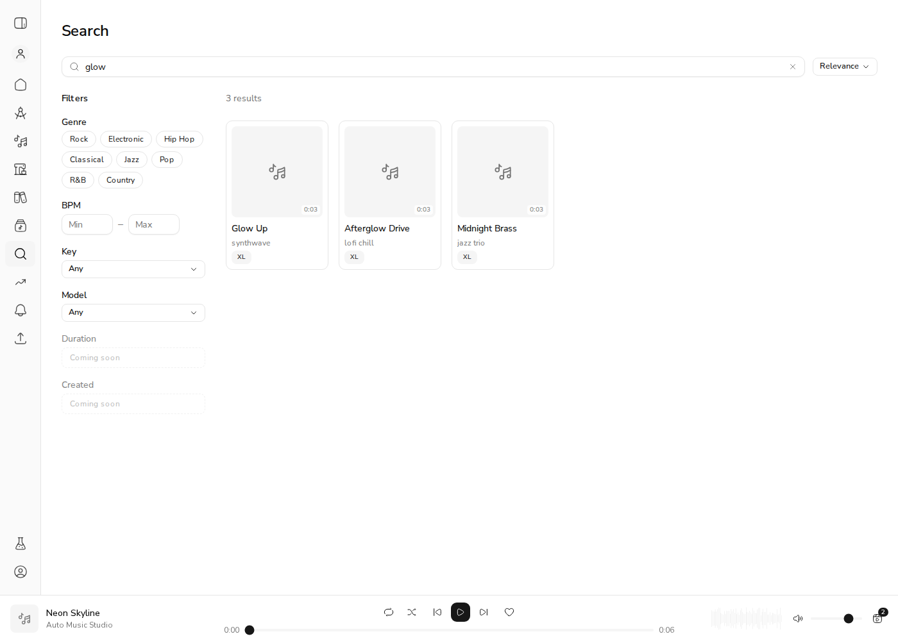
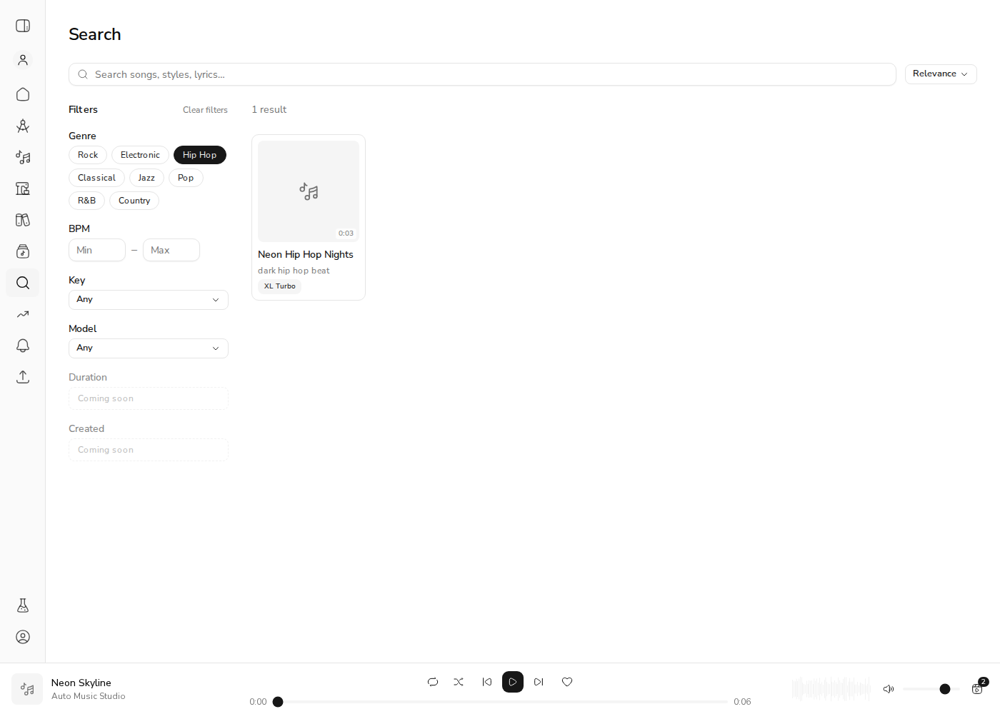
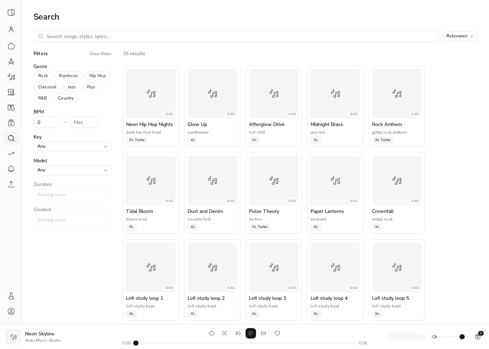

# Issue #651: public discovery API behind Feed, Explore and Search

*2026-10-31T21:21:37Z by Showboat 0.6.1*
<!-- showboat-id: fc0192c0-0ee0-479b-98a0-4a16bf8124f2 -->

Feed, Explore and Search now read real public clips through `GET /api/v1/discover/clips` and `/discover/facets`. They are reached through the web BFF at `/api/discover/*`. The demo database (`acemusic_demo_651`, via `scripts/demo_api_stack.py`) holds 26 listable public clips, plus one hidden clip of each kind: private, unlisted, removed by moderation, and public but owned by a banned user. The removed and banned clips were written *as public*, past the moderation sweep that would normally make them private, so the shared filter has to hold on its own.

```bash
. /tmp/claude-1000/-home-frankbria-projects-auto-music-studio/9fa29fb0-78dc-4147-8cef-12506ceecd11/scratchpad/demo-651/h.sh; mongosh --quiet $DB --eval 'db.clips.find({title: /^SECRET/}, {_id: 0, title: 1, visibility: 1, is_public: 1, removed_at: 1}).forEach(c => printjson(c)); print("owner of SECRET Banned glow banned_at:", db.users.findOne({_id: db.clips.findOne({title: "SECRET Banned glow"}).user_id}).banned_at)'
```

```output
{
  title: 'SECRET Private glow',
  removed_at: null,
  visibility: 'private',
  is_public: false
}
{
  title: 'SECRET Unlisted glow',
  removed_at: null,
  visibility: 'unlisted',
  is_public: false
}
{
  title: 'SECRET Removed glow',
  removed_at: ISODate('2026-10-31T21:20:55.533Z'),
  visibility: 'public',
  is_public: true
}
{
  title: 'SECRET Banned glow',
  removed_at: null,
  visibility: 'public',
  is_public: true
}
owner of SECRET Banned glow banned_at: ISODate('2026-10-31T21:20:55.531Z')
```

**AC: hidden clips never appear on any discovery endpoint.** Each call below runs anonymously through the web BFF, and every hidden title contains "glow". The default listing, a relevance search for "glow", a style search and the facets all leave them out. The 26 matches are the listable clips. The facets carry no `B minor` key and no `m-*` model, which belong only to the hidden clips.

```bash
. /tmp/claude-1000/-home-frankbria-projects-auto-music-studio/9fa29fb0-78dc-4147-8cef-12506ceecd11/scratchpad/demo-651/h.sh; echo "default listing: total=$(curl -s "$WEB/api/discover/clips?limit=50" | jq .total), SECRET titles: $(curl -s "$WEB/api/discover/clips?limit=50" | titles | grep -c SECRET)"; echo '--- q=glow, sort=relevance (title prefix > title > tag > lyrics) ---'; curl -s "$WEB/api/discover/clips?q=glow&sort=relevance" | titles; echo '--- style=hip-hop ---'; curl -s "$WEB/api/discover/clips?style=hip-hop" | titles; echo '--- facets ---'; curl -s "$WEB/api/discover/facets"; echo
```

```output
default listing: total=26, SECRET titles: 0
--- q=glow, sort=relevance (title prefix > title > tag > lyrics) ---
Glow Up
Afterglow Drive
Midnight Brass
--- style=hip-hop ---
Neon Hip Hop Nights
--- facets ---
{"keys":["A minor","C major","D major","D minor","E minor","F major","G major"],"models":["ace-step-v1","ace-step-v1-turbo"]}
```

**Filters combine.** E minor, 120–130 BPM, `ace-step-v1-turbo`: only "Rock Anthem" matches. "Crownfall" is E minor at 150 BPM, so it is excluded.

```bash
. /tmp/claude-1000/-home-frankbria-projects-auto-music-studio/9fa29fb0-78dc-4147-8cef-12506ceecd11/scratchpad/demo-651/h.sh; curl -s "$WEB/api/discover/clips?key=E%20minor&bpm_min=120&bpm_max=130&model=ace-step-v1-turbo" | jq -c '.clips[] | {title, key, bpm, model}'
```

```output
{"title":"Rock Anthem","key":"E minor","bpm":128,"model":"ace-step-v1-turbo"}
```

**AC: paging is stable under inserts.** First fetch a page of 4. Then insert a brand-new public clip, newer than everything else. The next page, fetched with the first page's cursor, continues where page 1 stopped: no clip repeats, and the new clip doesn't shift the boundary. Walking every page afterwards visits each of the 27 clips exactly once.

```bash
. /tmp/claude-1000/-home-frankbria-projects-auto-music-studio/9fa29fb0-78dc-4147-8cef-12506ceecd11/scratchpad/demo-651/h.sh; p1=$(curl -s "$WEB/api/discover/clips?limit=4"); echo page1: $(echo "$p1" | titles | paste -sd,); mongosh --quiet $DB --eval 'const c = db.clips.findOne({title: "Glow Up"}); db.clips.insertOne({user_id: c.user_id, workspace_id: c.workspace_id, file_path: "x.wav", format: "wav", title: "Inserted Between Pages", style_tags: [], parent_clip_ids: [], moderation_flags: [], content_warning: false, removed_at: null, visibility: "public", is_public: true, created_at: new Date()}); print("inserted a newer public clip")'; cur=$(echo "$p1" | jq -r .next_cursor); echo page2: $(curl -s "$WEB/api/discover/clips?limit=4&cursor=$cur" | titles | paste -sd,); seen=''; c=''; while :; do b=$(curl -s "$WEB/api/discover/clips?limit=7${c:+&cursor=$c}"); seen="$seen$(echo "$b" | jq -r '.clips[].id')"$'\n'; c=$(echo "$b" | jq -r '.next_cursor // empty'); [ -z "$c" ] && break; done; echo "full walk: $(echo "$seen" | grep -c .) ids, $(echo "$seen" | grep . | sort -u | wc -l) unique"
```

```output
page1: Neon Hip Hop Nights,Glow Up,Afterglow Drive,Midnight Brass
inserted a newer public clip
page2: Rock Anthem,Tidal Bloom,Dust and Denim,Pulse Theory
full walk: 27 ids, 27 unique
```

**Error path.** A forged cursor and a cursor replayed under the other sort are both a 422, passed through the BFF.

```bash
. /tmp/claude-1000/-home-frankbria-projects-auto-music-studio/9fa29fb0-78dc-4147-8cef-12506ceecd11/scratchpad/demo-651/h.sh; curl -s -w ' HTTP %{http_code}\n' "$WEB/api/discover/clips?cursor=forged"; c=$(curl -s "$WEB/api/discover/clips?limit=1" | jq -r .next_cursor); curl -s -w ' HTTP %{http_code}\n' "$WEB/api/discover/clips?q=glow&sort=relevance&cursor=$c"
```

```output
{"detail":"Invalid cursor."} HTTP 422
{"detail":"Invalid cursor."} HTTP 422
```

**Feed audio is real.** Each feed item's `<audio>` points at `/api/clips/{id}/stream`. A signed-out request for a public clip streams its WAV, and a hidden clip gets a 404.

```bash
. /tmp/claude-1000/-home-frankbria-projects-auto-music-studio/9fa29fb0-78dc-4147-8cef-12506ceecd11/scratchpad/demo-651/h.sh; id=$(curl -s "$WEB/api/discover/clips?q=Neon" | jq -r '.clips[0].id'); curl -s -o /dev/null -w 'public clip stream (Neon Hip Hop Nights): HTTP %{http_code} %{content_type} %{size_download} bytes\n' "$WEB/api/clips/$id/stream"; curl -s -o /dev/null -w 'private clip stream: HTTP %{http_code}\n' "$WEB/api/clips/$HIDDEN_PRIVATE/stream"
```

```output
public clip stream (Neon Hip Hop Nights): HTTP 200 audio/wav 132344 bytes
private clip stream: HTTP 404
```

```bash
. /tmp/claude-1000/-home-frankbria-projects-auto-music-studio/9fa29fb0-78dc-4147-8cef-12506ceecd11/scratchpad/demo-651/h.sh; mongosh --quiet $DB --eval 'print("removed the audio-less inserted clip:", db.clips.deleteOne({title: "Inserted Between Pages"}).deletedCount)'
```

```output
removed the audio-less inserted clip: 1
```

**AC: Explore shows real public clips.** It has two sections: Genre Channels, as static tiles linking to Search, and New Releases, the 12 newest public clips from the API. Trending, Staff Picks and Charts are gone because there are no play, like or share counters and no staff-pick flag to back them. No SECRET clip appears.

```bash {image}

```



**AC: Feed shows real public clips.** Measured in the browser, signed out. The first page holds the 5 newest public clips: Neon Hip Hop Nights, Glow Up, Afterglow Drive, Midnight Brass, Rock Anthem. Scrolling to the sentinel fetched the next cursor page and appended Tidal Bloom, Dust and Denim, Pulse Theory, Paper Lanterns and Crownfall, for 10 items with no repeats. Each item's `<audio src>` is `/api/clips/{id}/stream`. The first one loaded the clip's real 3-second WAV (`readyState` 4, `duration` 3, no media error), where the mock used to play one shared sample. There is no artist line, because a public clip carries no owner identity.

```bash {image}

```



**AC: Search shows real public clips.** Measured in the browser, signed out:
- `/search?q=glow` shows "3 results": Glow Up, Afterglow Drive, Midnight Brass, in relevance order. None of the four hidden "SECRET … glow" clips appears.
- Clicking Explore's **Hip Hop** genre tile goes to `/search?style=hip-hop` and shows "1 result", Neon Hip Hop Nights, whose tag is the prompt "dark hip hop beat". The hidden clips tagged "hip hop" stay out.
- `/search?bpm_min=0` shows "26 results" with 20 cards. **Load more** appended the remaining 6 (26 cards, 26 unique) and then disappeared, because `next_cursor` was null.

```bash {image}

```



```bash {image}

```



```bash {image}

```



## Evidence by acceptance criterion

| Criterion | Action | Outcome evidence | Status |
|---|---|---|---|
| Feed, Explore and Search show real public clips from a seeded database | Opened all three pages signed out against `acemusic_demo_651` | Explore New Releases shows the seeded titles. The Feed showed 5 clips, then 10 after infinite scroll, with real WAV audio. Search shows q=glow → 3 in relevance order, the Hip Hop tile → 1, and bpm_min=0 → 20, then 26 after Load more | VERIFIED |
| Private, unlisted, removed or banned-owner clips never appear | Listing, text search, style search and facets, through the BFF | 0 SECRET titles, total 26 = listable clips only. No hidden key or model in the facets. Also covered by an integration test per case | VERIFIED |
| Paging stable under inserts | Page 1, then insert a newer clip, then page 2 with the cursor; then a full walk | Page 2 continues at Rock Anthem with no repeats. The full walk visits 27 ids, 27 unique | VERIFIED |
| #578 can build on this | Inspect the listing payload | Every clip carries `content_warning` (Neon Hip Hop Nights: `true`) | VERIFIED |

Hidden on purpose (no data source): Trending, Staff Picks, Charts, the "Most Popular" sort, and the feed artist line. The global playbar's default queue (`lib/demo-tracks.ts`, "Neon Skyline") is separate from discovery and unchanged.
