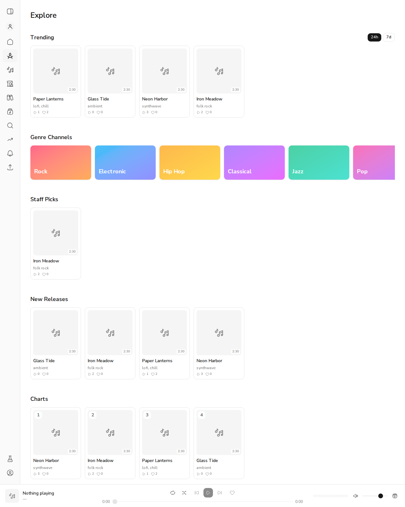
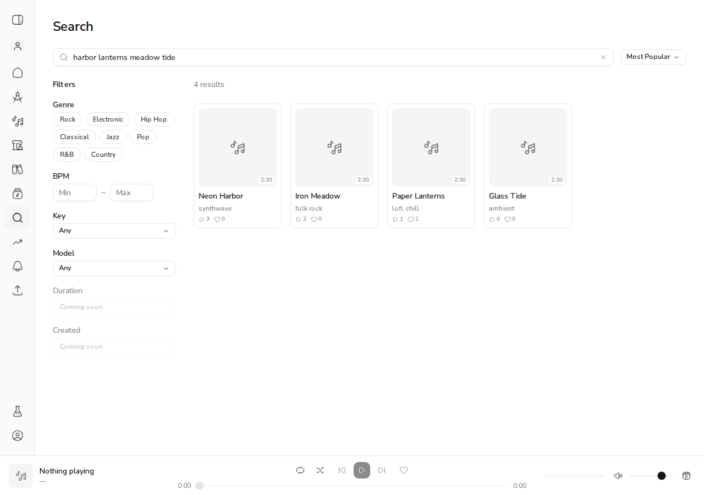

# #656: Trending, Staff Picks, Charts and Most Popular on staging

*2026-11-02T08:55:59Z by Showboat 0.6.1*
<!-- showboat-id: fbb9f5db-1b7f-4405-a181-3b545c2bdff2 -->

Staging (https://dev.automusicstudio.com, build d395e7a) with four seeded public songs. Their engagement was recorded through the live API: Neon Harbor 3 plays, Iron Meadow 2 plays and an admin staff pick, Paper Lanterns 1 play and 2 likes, Glass Tide 1 share. Trending = plays + 3 x likes + 5 x shares.

```bash
for s in trending_24h popular staff_picks; do printf "%s: " $s; curl -s "https://dev.automusicstudio.com/api/discover/clips?sort=$s" | python3 -c "import json,sys;print([(c[\"title\"],c[\"play_count\"],c[\"like_count\"]) for c in json.load(sys.stdin)[\"clips\"]])"; done
```

```output
trending_24h: [('Paper Lanterns', 1, 2), ('Glass Tide', 0, 0), ('Neon Harbor', 3, 0), ('Iron Meadow', 2, 0)]
popular: [('Neon Harbor', 3, 0), ('Iron Meadow', 2, 0), ('Paper Lanterns', 1, 2), ('Glass Tide', 0, 0)]
staff_picks: [('Iron Meadow', 2, 0)]
```

Explore on staging: Trending (24h toggle), Staff Picks (Iron Meadow), New Releases, and Charts numbered by all-time plays. Each card shows public plays and likes; shares stay admin-only.

```bash {image}
docs/demos/issue-656-explore.png
```



Search with sort=popular (Most Popular) ranks the matches by plays: Neon Harbor 3, Iron Meadow 2, Paper Lanterns 1, Glass Tide 0.

```bash {image}
docs/demos/issue-656-search-popular.png
```



Trending's 7d toggle presses and reloads the row from trending_7d (checked in the browser; the same clips rank in the same order, since everything was recorded today).
