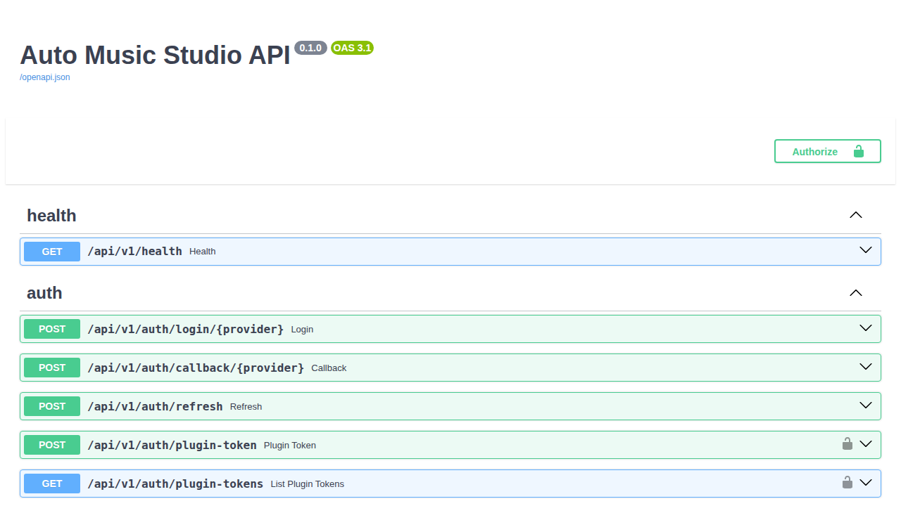
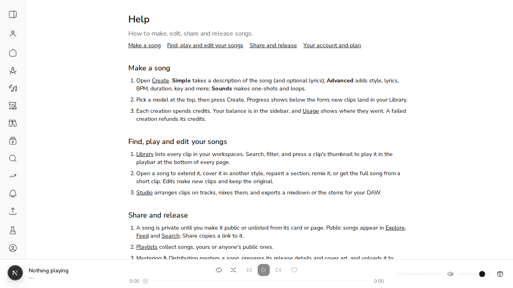
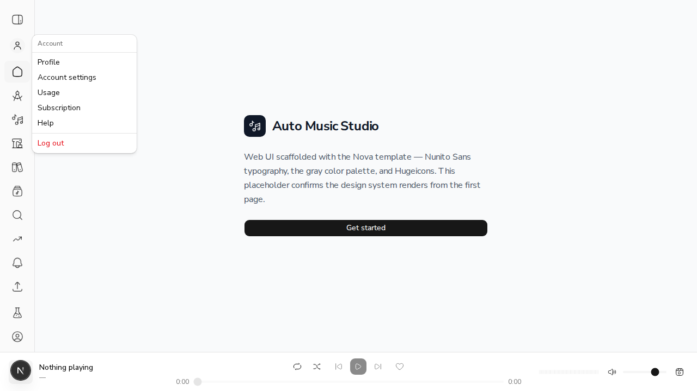

# US-28.5 (#342, PR #721): /docs on the site, in-app help, uptime monitor, deployment guide

*2026-11-02T16:46:15Z by Showboat 0.6.1*
<!-- showboat-id: f8859b90-f5b4-485c-9a08-dcbeedb84e34 -->

Live stack: the API from scripts/demo_api_stack.py on :8755 (throwaway acemusic_demo_721 database), the web dev server on :3721 with API_BASE_URL pointing at it, and a webhook receiver on :8799 that appends every POST it gets to alerts.log.

## Uptime monitor alerts when the health endpoint is unreachable for over 2 minutes
The monitor runs once a minute. It should stay quiet for the first two failed checks, alert once on the third, stay quiet while the outage continues, and alert once on recovery. Here the API is stopped and the monitor runs on its own state file.

```bash
D=$DEMO_DIR; S=$D/uptime-state; rm -f $S $D/alerts.log; touch $D/alerts.log
export HEALTH_URL=http://127.0.0.1:8755/api/v1/health ALERT_WEBHOOK_URL=http://127.0.0.1:8799/ STATE_FILE=$S CHECK_TIMEOUT=2
kill $(cat $D/pid); sleep 2
for minute in 1 2 3 4; do bash scripts/uptime-monitor.sh 2>/dev/null; echo "minute $minute (API down): state=[$(cat $S)] alerts posted=$(wc -l < $D/alerts.log)"; done
cat $D/alerts.log
```

```output
minute 1 (API down): state=[1 0] alerts posted=0
minute 2 (API down): state=[2 0] alerts posted=0
minute 3 (API down): state=[3 1] alerts posted=1
minute 4 (API down): state=[4 1] alerts posted=1
application/json {"text": "Down: http://127.0.0.1:8755/api/v1/health has failed 3 checks in a row."}
```

The API is started again, and the monitor runs twice more.

```bash
D=$DEMO_DIR; S=$D/uptime-state
export HEALTH_URL=http://127.0.0.1:8755/api/v1/health ALERT_WEBHOOK_URL=http://127.0.0.1:8799/ STATE_FILE=$S CHECK_TIMEOUT=2
curl -s $HEALTH_URL; echo
for minute in 5 6; do bash scripts/uptime-monitor.sh; echo "minute $minute (API up): state=[$(cat $S)] alerts posted=$(wc -l < $D/alerts.log)"; done
cat $D/alerts.log
```

```output
{"status":"ok","version":"0.1.0","uptime_seconds":1.043,"build_sha":"unknown"}
minute 5 (API up): state=[0 0] alerts posted=2
minute 6 (API up): state=[0 0] alerts posted=2
application/json {"text": "Down: http://127.0.0.1:8755/api/v1/health has failed 3 checks in a row."}
application/json {"text": "Recovered: http://127.0.0.1:8755/api/v1/health is answering again."}
```

## /docs serves auto-generated OpenAPI documentation
Both requests go to the web server on :3721, not the API. The Swagger page loads its schema from /openapi.json on the same origin, which the web proxies too.

```bash
curl -s -D - -o /tmp/docs.html http://localhost:3721/docs | grep -iE "^(HTTP|content-type)"; grep -oE "swagger-ui-bundle.js|url: '/openapi.json'|<title>[^<]*</title>" /tmp/docs.html
curl -s -D /tmp/oa.h -o /tmp/oa.json http://localhost:3721/openapi.json; grep -iE "^(HTTP|content-type)" /tmp/oa.h
python3 -c "import json; s=json.load(open(\"/tmp/oa.json\")); print(s[\"openapi\"], \"|\", s[\"info\"][\"title\"], \"|\", len(s[\"paths\"]), \"paths |\", \"/api/v1/health\" in s[\"paths\"])"
curl -s http://localhost:8755/openapi.json | cmp - /tmp/oa.json && echo "identical to the API's own schema"
```

```output
HTTP/1.1 200 OK
content-type: text/html; charset=utf-8
<title>Auto Music Studio API - Swagger UI</title>
swagger-ui-bundle.js
url: '/openapi.json'
HTTP/1.1 200 OK
content-type: application/json
3.1.0 | Auto Music Studio API | 119 paths | True
identical to the API's own schema
```

Swagger UI rendered by the browser from the web origin (:3721/docs). It shows the API's operations, starting with /api/v1/health, and the Authorize button:

```bash {image}

```



## User guide: in-app help pages covering core workflows
/help has four sections: making a song, the library and editing, sharing and releasing, and your account and plan. The sidebar's account menu now has a Help item. Clicking it in the browser landed on /help (`location.pathname` = /help, h1 = Help), and /support's text now says "Most questions are answered in Help", with the link pointing to /help.

```bash {image}

```



```bash {image}

```



## Deployment guide enables deploying from scratch
docs/deployment.md has a new section, "Deploy from scratch on a VPS". During review, Codex found its Google OAuth redirect wrong: it pointed at the POST-only BFF route. The guide now gives the browser callback page instead. A browser's GET shows the difference:

```bash
for p in /auth/callback/google /api/auth/callback/google; do printf "GET %-28s -> " $p; curl -s -o /dev/null -w "%{http_code}\n" "http://localhost:3721$p?code=x&state=y"; done; grep -o "redirect \`[^\`]*\`" docs/deployment.md
```

```output
GET /auth/callback/google        -> 200
GET /api/auth/callback/google    -> 405
redirect `https://example.com/auth/callback/google`
```

## An unhandled error reaches Sentry exactly once (#718 follow-up)

```bash
uv run pytest tests/test_observability.py tests/test_uptime_monitor.py -q -p no:cacheprovider 2>&1 | tail -2
```

```output
TOTAL                                              14782   9906    33%
20 passed, 4 warnings in 4.13s
```
