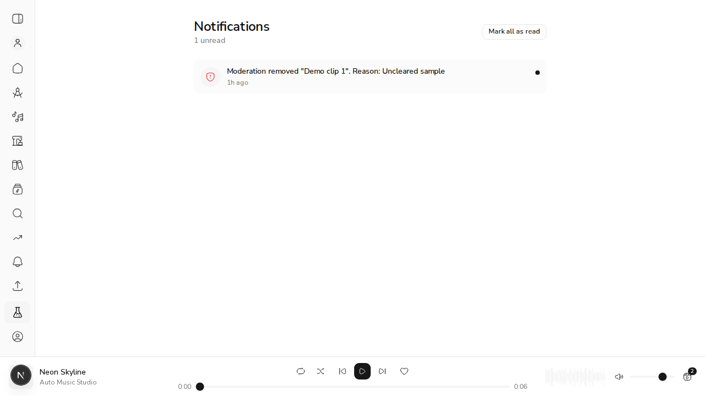
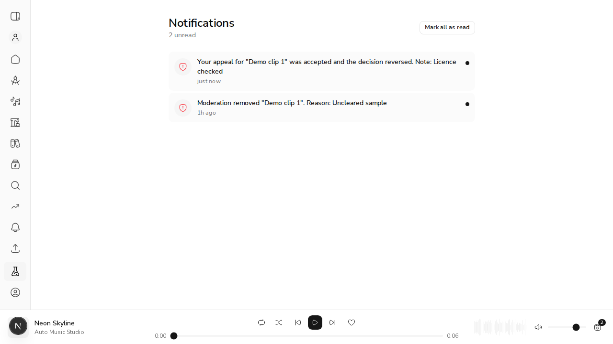

# #566 New server notices reach an open session

*2026-11-01, real browser (agent-browser) against `next dev` and the live demo API*

**How it ran.** `scripts/demo_api_stack.py` ran the API on a throwaway `acemusic_demo_566` database. `next dev` pointed its BFF at it (`API_BASE_URL`). For the demo, the real `NotificationsProvider` + `NotificationsView` were mounted on `/labs` with the seeded musician's real access token. Every inbox read went browser → BFF → API → Mongo. The mount was reverted afterwards.

## 1. The inbox loads with one notice

The page as loaded: `1 unread`, "Moderation removed "Demo clip 1". Reason: Uncleared sample".



## 2. A new notice is written on the server while the page stays open

An appeal outcome (`moderation_appeal_reversed`) is inserted into `notification_events` directly. The page's text two seconds later is still the old inbox:

```output
"Notifications\n\n1 unread\n\nMark all as read\nModeration removed \"Demo clip 1\". Reason: Uncleared sample\n1h ago"
```

## 3. The tab regains focus, and the notice and the badge arrive with no reload

`window.dispatchEvent(new Event("focus"))`, then the page text, and the number of inbox requests the page made: the first load, which React dev mode runs twice, plus the focus refresh.

```output
"Notifications\n\n2 unread\n\nMark all as read\nYour appeal for \"Demo clip 1\" was accepted and the decision reversed. Note: Licence checked\njust now\nModeration removed \"Demo clip 1\". Reason: Uncleared sample\n1h ago"
3
```



The same refresh also runs every 60s while signed in. The unit tests cover that, plus keeping "Show older" pages and live `notify()` rows, and the Library's appeal status refetching when an appeal outcome arrives (`contexts/notifications-context.test.tsx`, "live inbox (#566)").
