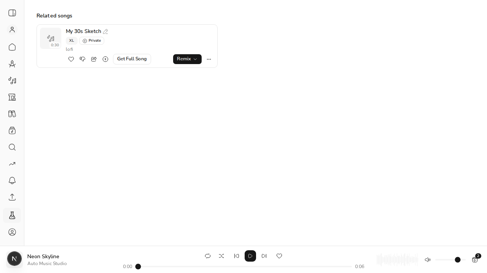
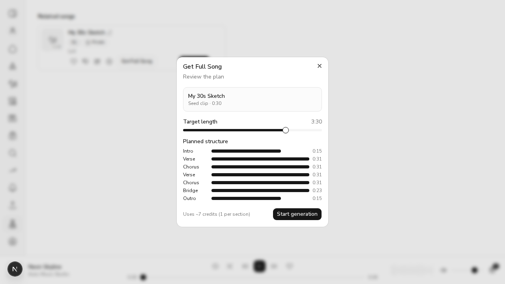

# #616 Get Full Song on Related songs cards opens the wizard

*2026-11-01, real browser (agent-browser) against `next dev`*

**How it ran.** The real `RelatedSongs` component was mounted on `/labs` for the demo. Its similar-clips request was answered with one 30-second clip the viewer owns (`is_owner: true`), and a signed-in auth context was supplied, because `useSimilarClips` only fetches with a token. The mount was reverted afterwards. Before the fix, clicking **Get Full Song** on this card did nothing, because `RelatedSongs` never passed `onGetFullSong` to `ClipCard`.

## 1. The rail shows the owner's short clip with Get Full Song



## 2. Clicking it opens the full-song wizard for that clip

The dialog read back from the DOM after the click:

```output
{"dialog":"Get Full Song","text":"Get Full SongReview the planMy 30s SketchSeed clip · 0:30Target length3:30Planned structureintro0:15verse0:31chorus0:31verse0:31chorus0:31bridge0:23outro0:15Use"}
```



## 3. A card whose caller can't handle it no longer shows the button

`ClipCard` now renders Get Full Song only when `onGetFullSong` is passed:

```output
✓ components/workspace/ClipCard.test.tsx > ClipCard > hides Get Full Song when the caller can't handle it (#616)
 ✓ components/song/RelatedSongs.test.tsx > RelatedSongs Get Full Song (#616) > opens the full-song wizard for your own short clip
      Tests  2 passed | 47 skipped (49)
```
