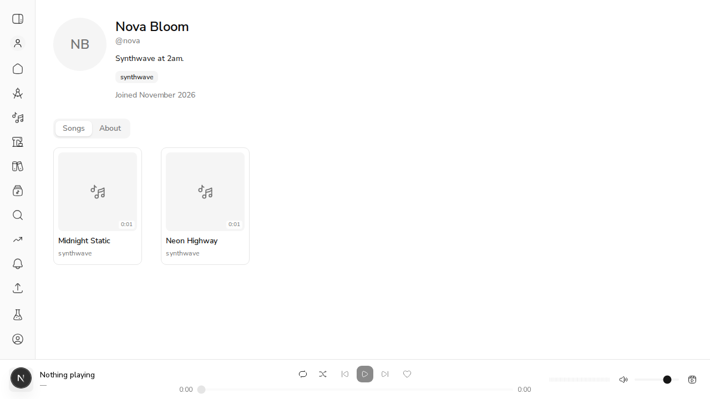
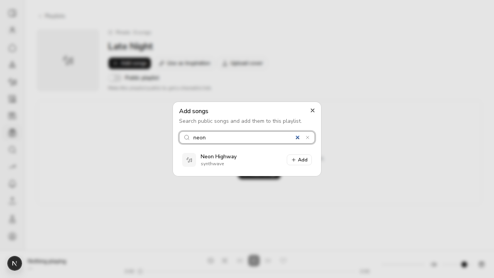
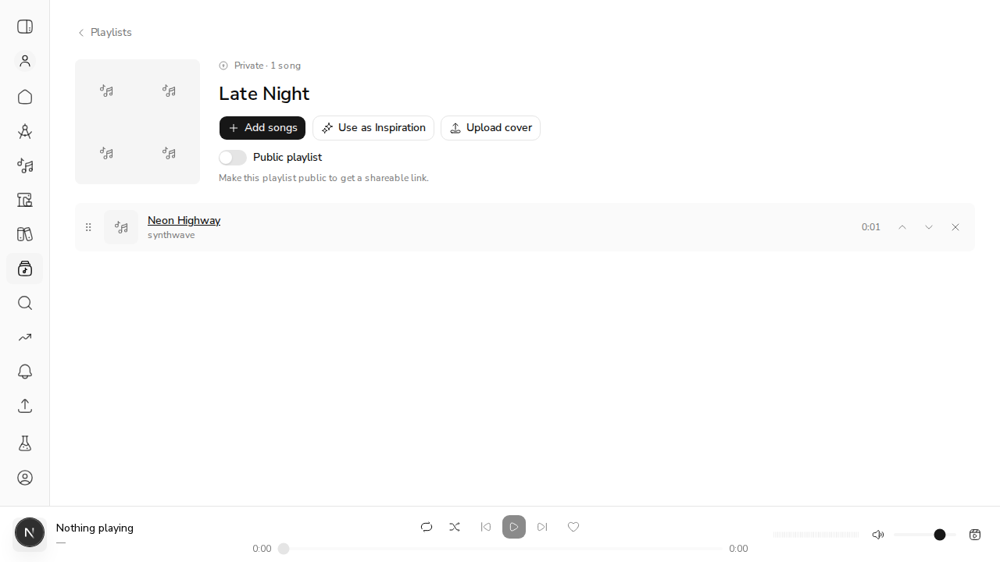

# #654 Profiles, the playlist picker and the playbar read real data

*2026-11-01, real browser (agent-browser) against `next dev` and the live demo API*

**How it ran.** `scripts/demo_api_stack.py` ran the API on a throwaway `acemusic_demo_654` database. The seeded musician was given the handle `nova`, a display name and bio, and two public clips ("Neon Highway", "Midnight Static"). `next dev` pointed its BFF at it. Nothing in the web app reads a mock clip pool any more: `web/lib/mock-clips.ts` and `web/lib/demo-tracks.ts` are deleted.

## 1. `/@nova` reads the public profile API

Page text, read from the DOM:

```output
"NB\nNova Bloom\n\n@nova\n\nSynthwave at 2am.\n\nsynthwave\n\nJoined November 2026\n\nSongs\nAbout\n0:01\nMidnight Static\n\nsynthwave\n\n0:01\nNeon Highway\n\nsynthwave"
```



An unknown handle is a 404:

```output
"404\nThis page could not be found.\n\nNothing playing\n\n—\n\n0:00\n0:00"
```

## 2. The playbar starts empty, with no demo tracks

```output
"Nothing playing\n\n—\n\n0:00\n0:00"
```

## 3. The playlist picker searches real public clips

A new playlist "Late Night" was created. In **Add songs**, typing "neon" leaves only the matching real clip:

```output
- button "Add Neon Highway" [ref=e3]
```



After adding it, the playlist shows the real clip:

```output
"Playlists\nPrivate · 1 song\nLate Night\nAdd songs\nUse as Inspiration\nUpload cover\nPublic playlist\n\nMake this playlist public to get a shareable link.\n\nNeon Highway\nsynthwave\n0:01"
```


